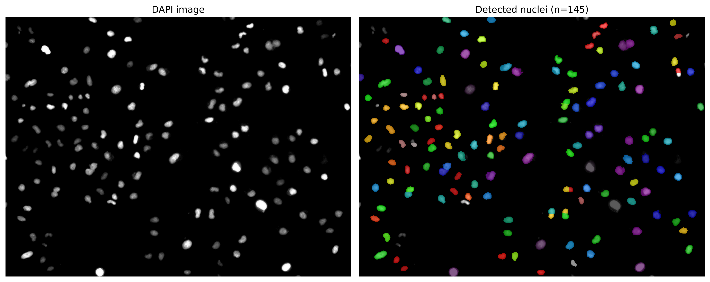
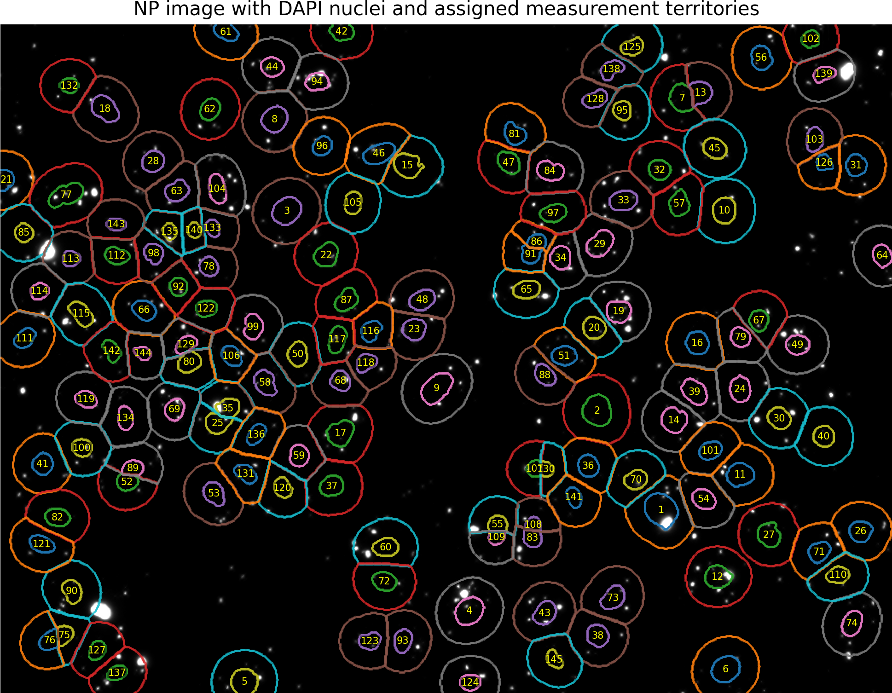
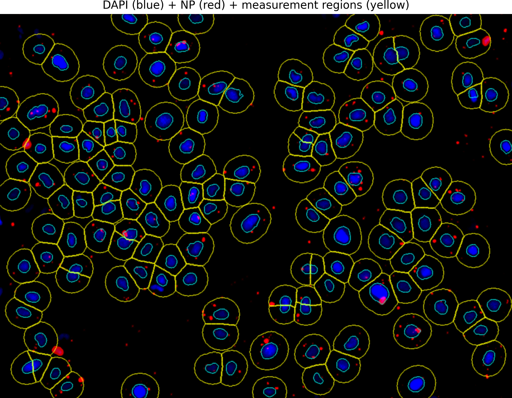

# NanoCyte-Image-Analyzer
NanoCyte is an image analysis pipeline that quantifies cell-associated nanoparticle fluorescence. 

Inputs: spatially aligned pair of TIFFs
  - DAPI channel used to identify and segment nuclei
  - Nanoparticle channel is what is quantified

After segmenting nuclei, NanoCyte expands a measurement territory outward from each nucleus by a user-defined radius. Pixels within overlapping territories are assigned to the nearest nucleus. Mean and integrated nanoparticle fluorescence are then calculated within each territory.

Note: Measurement territories are approximations based on nuclear position and a fixed expansion radius; they do not represent experimentally segmented cell boundaries. Nanoparticle fluorescence intersecting with DAPI nuclei are included in quantification.

## Workflow
1. Load and validate paired images
2. Smooth and subtract background from DAPI image
3. Identify nuclei using an Otsu threshold
4. Separate touching nuclei using watershed segmentation
5. Filter segmented objects by size and circularity
6. Estimate and subtract background fluorescence from nanoparticle channel
7. Generate nucleus-centered measurement territories
8. Quantify fluroescence within each territory
9. Export measurements and image outputs

Requirements: python3 with NumPy, pandas, tifffile, Matplotlib, Scipy, and scikit-image packages
Make sure DAPI and nanoparticle images have the suffixes `*_dapi` and `*_np`, but these can be changed in the raw code if needed. 

use ```pip install numpy pandas tifffile matplotlib scipy sciki-image``` in your terminal with python installed for packages.

## Instructions
- Install all files and launch using .bat file
- A GUI will pop up, allowing user-defined tuning of parameters

## Output files
  - `*_cell_associated_nanoparticle_fluorescence.csv`: Per-cell fluorescence measurements and area measurements
  - `*_dapi_segmentation.png`: DAPI image and labeled nuclear segmentation
  - `*_nuclues_mask.tif`: Labeled nuclear mask
  - `*_measurement_radii.png`: Nanoparticle channel image with nuclear boundaries and assigned territories
  - `*_combined_overlay.png`: Compositive DAPI and nanoparticle fluorescence image with measurement-region outlines

The CSV includes:
  - `cell_id`
  - `nucleus_area_px`
  - `cell_area_px`
  - `mean_cell_fluorescence`
  - `integrated_cell_fluorescence`

Make sure to review all overlays to ensure accurate nuclear identification and measurement territory! Image processing parameters may need to be adjusted based on images. The default parameters were made for 20X images. 

## Parameters
1. Minimum nucleus area: Minimum area required for a segmented object to be considered a nucleus; smaller objects are excluded (default: 150)
2. Maximum nucleus area: Maximum area allowed for a segmented nucleus; larger objects are excluded (default: 5000)
3. Minimum circularity: Minimum circularity required for an object to be retained; used to exclude irregularly shaped objects that aren't likely to be nuclei (default: 0.25)
4. Cell radius: Distance that the measurement extends outward from the segmented nuclear boundary. This region is used to quantify fluorescence per cell (default: 20)
5. Background sigma: Gaussian smoothing parameter to estimate and subtract broad background signal in nanoparticle channel during nuclear segmentation (default: 10)
6. DAPI background sigma: Smoothing parameter to subtract background in DAPI channel (default: 30)
7. Otsu threshold: Scaling factor used to identify foreground pixels in DAPI image (default: 0.05)
8. Minimum watershed distance: Minimum separation between local maxima used to generate watershed markers for separating adjacent/touching nuclei (default: 5)

## Example image output






